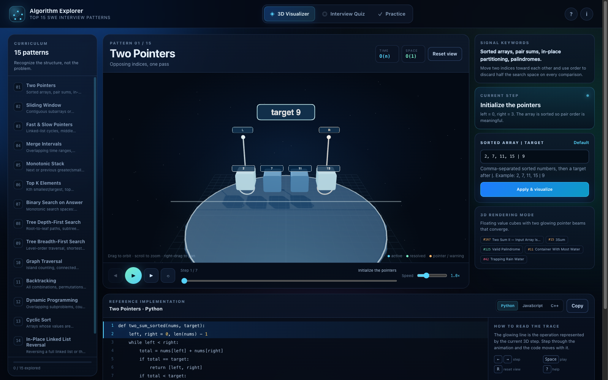

# Algorithm Explorer Studio

An OpenCode skill for building a release-grade, zero-asset 3D algorithm-pattern explorer: fifteen
deterministic step engines, fifteen procedural Three.js scenes, mark-synchronized Python/JavaScript/C++
code, a recognition quiz, local practice tracking, 106 checks and a GitHub Pages release.



## Install

Copy this directory to your OpenCode skills directory, or add the catalog URL:

```jsonc
{
  "skills": ["https://somphol.github.io/opencode-skills/"]
}
```

Local path: `~/.config/opencode/skills/algorithm-explorer-studio`

## Use

Ask for a 3D algorithm visualizer, a pattern-based interview study app, or a step-through code/3D
teaching studio. The skill tells the agent to build data → engines → shell → scenes → controller →
tests → docs → release, and gives it a working reference to copy.

## Scaffold

```sh
node scripts/new-project.mjs --out ~/Projects/my-algorithm-explorer
cd ~/Projects/my-algorithm-explorer
python3 -m http.server 8080
node --test tests/engine.test.mjs tests/static.test.mjs
```

Prove the skill from a clean temp directory:

```sh
node scripts/verify.mjs              # engine + static
node scripts/verify.mjs --browser    # also the 35-check Chrome suite
```

## What is inside

| Path | Purpose |
| --- | --- |
| `SKILL.md` | model-facing workflow, gates, non-negotiables, recipes |
| `references/method.md` | schemas, build order, scene recipes, adding a pattern |
| `references/lessons.md` | the bugs that cost time and how to avoid them |
| `references/verification.md` | the 106-check gate and harness details |
| `references/release.md` | docs set, Pages, keychain-safe GitHub, state capture |
| `assets/reference/` | the complete working app and its docs/tests |
| `scripts/new-project.mjs` | scaffold from the reference |
| `scripts/verify.mjs` | scaffold into a temp dir and run the gates |

## Provenance

Built from [Algorithm Explorer](https://github.com/somphol/algorithm-explorer), MIT © 2026 Somphol
Boonjing, with OpenCode + DeepSeek V4.1 Flash. Three.js r128 / OrbitControls are MIT. Curriculum
inspired by Grokking the Coding Interview, NeetCode 150 and Blind 75; no paid content is reproduced.
See [ATTRIBUTION.md](ATTRIBUTION.md).
