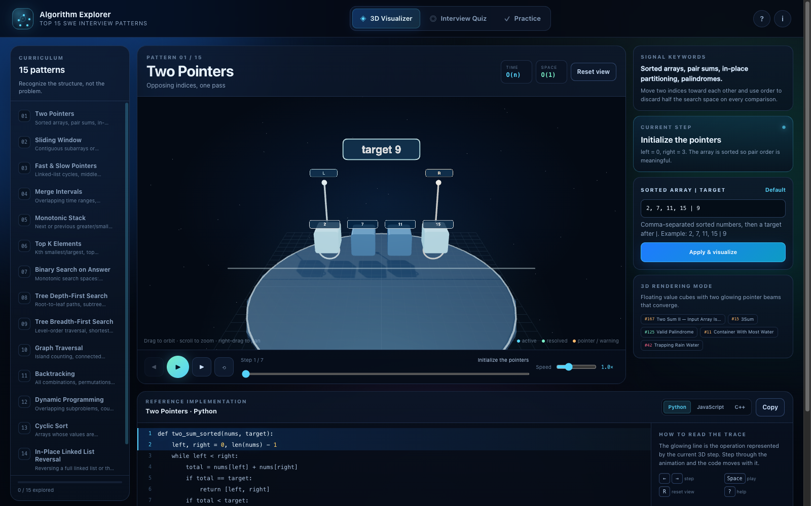

# Algorithm Explorer

**Top 15 SWE Interview Patterns — an interactive 3D study studio.**

[](https://somphol.github.io/algorithm-explorer/)
[](#deploy)
[](#verification)
[](LICENSE)



Algorithm Explorer turns the recurring structures behind coding interviews into fifteen distinct,
step-through 3D scenes. Each pattern has a deterministic trace engine, synchronized Python /
JavaScript / C++ source, canonical LeetCode links, a recognition quiz and a practice checklist that
survives a reload. It is a teaching model, not a judge: there is no backend, no account, no build
step and no analytics.

Inspired by three industry curricula: **Grokking the Coding Interview** (Design Gurus), the
**NeetCode 150** roadmap and the **Blind 75**.

## What is inside

| Area | Count | What it does |
| --- | ---: | --- |
| Patterns | 15 | Two Pointers through Union-Find, each with its own 3D scene |
| Step engines | 15 | Pure functions compile custom input into deterministic frames |
| Reference implementations | 45 | Python, JavaScript and C++ for every pattern |
| Canonical problems | 61 | Outbound LeetCode links, grouped by pattern and difficulty |
| Quiz prompts | 30 | Scenario → pattern recognition, immediate explanation |
| Local persistence | 3 keys | practice checkboxes, preferences, quiz personal best |
| Verification | 106 checks | 47 Node (27 engine + 20 static) + 35 browser + 24 in-page |

## Quick start

There is nothing to install and nothing to build.

```bash
cd algorithm-explorer
python3 -m http.server 8080     # then open http://localhost:8080/
npm start                       # the same server
```

Three.js and OrbitControls are loaded from pinned CDNs (`r128` / `0.128.0`). The quiz, practice
tracker, code viewer and step engines still work if the CDN or WebGL is unavailable; the stage shows a
graceful fallback.

## The three tabs

### 3D Visualizer Studio

Pick a pattern from the curriculum rail. Orbit, zoom and pan the scene; step, play, scrub or change
speed. The active 3D state and the highlighted source line move together. Every pattern accepts a
custom input in a compact grammar, so the trace is regenerated from your data rather than a canned
animation.

### Interview Quiz

Thirty scenarios ask which pattern the signal points to, not what syntax to write. Every answer
explains the reasoning and can jump straight back to that pattern in 3D. The best completion
percentage is stored locally.

### Practice & Exercises

Sixty-one curated problems grouped by pattern, filterable by difficulty and searchable. Checkboxes
record completion in `localStorage`; no account leaves the browser.

## Input grammar

| Pattern | Default | Grammar |
| --- | --- | --- |
| Two Pointers | `2, 7, 11, 15 \| 9` | sorted numbers `\|` target (unsorted input is sorted and flagged) |
| Sliding Window | `abcabcbb` | any short string |
| Fast & Slow | `7 \| 3` | node count `\|` 0-based cycle entry (`-1` for acyclic) |
| Merge Intervals | `1,3; 2,6; 8,10; 15,18` | `start,end` pairs separated by `;` |
| Monotonic Stack | `73, 74, 75, 71, 69, 72, 76, 73` | comma-separated numbers |
| Top K | `3, 2, 1, 5, 6, 4 \| 2` | numbers `\|` k |
| Binary Search on Answer | `3, 6, 7, 11 \| 8` | piles `\|` hour budget |
| Tree DFS | `5,4,8,11,null,13,4,7,2,null,null,5,1 \| 22` | level-order values `\|` target sum |
| Tree BFS | `3, 9, 20, null, null, 15, 7` | level-order values; `null` for gaps |
| Graph Traversal | `11000/11000/00100/00011` | rows separated by `/`; `1` land, `0` water |
| Backtracking | `1, 2, 3` | up to 4 distinct numbers |
| Dynamic Programming | `1, 2, 5 \| 11` | coins `\|` amount (0–20) |
| Cyclic Sort | `3, 0, 1` | values in `0…N` with one missing |
| Reverse Linked List | `1, 2, 3, 4, 5` | node values |
| Union-Find | `1,2; 1,3; 2,3` | `a,b` edges separated by `;` |

Malformed input is rejected inline and the previous trace remains intact.

## Architecture at a glance

```
index.html          three tab shells, dialogs, CDN script order
css/style.css       dark visual system, responsive studio grid, reduced-motion rules
js/data.js          15 patterns, 45 code listings, 61 problems, 30 quiz questions
js/algorithms.js    15 pure step engines + parsers; no DOM, no Three.js
js/scene.js         one renderer, 15 procedural Three.js scene builders
js/app.js           controller: tabs, transport, code sync, quiz, practice, self-test
tests/              engine, static and headless-browser suites
scripts/            screenshots
docs/               architecture, reproduction book, curriculum, testing, release
```

The full runtime map is in [docs/ARCHITECTURE.md](docs/ARCHITECTURE.md). The rebuild book for another
agent is [docs/REPRODUCTION.md](docs/REPRODUCTION.md). The short handoff is [AGENTS.md](AGENTS.md).

## Verification

```bash
npm test                 # 47 engine + static checks
npm run test:browser     # 35 real-browser checks, zero console errors
node tests/browser.test.mjs --screenshots   # not used; screenshots are separate
npm run screenshot       # regenerate assets/*.png
```

The browser suite launches one headless Chrome with `--use-mock-keychain`, so it never touches the
macOS Keychain. It verifies every one of the 15 scenes, the transport, custom input, all three
language tabs, quiz feedback, a full 30-question round, practice persistence across reload, dialogs,
keyboard shortcuts and a 390 px mobile layout. Details: [docs/TESTING.md](docs/TESTING.md).

## Deploy

The repository root is the site. GitHub Pages serves `index.html`, `css/`, `js/`, `assets/` and
`docs/` directly; `.nojekyll` is present so `_`-prefixed paths are never filtered.

```bash
git push origin main
# Settings → Pages → Deploy from a branch → main / (root)
```

Live: <https://somphol.github.io/algorithm-explorer/>. Operations and keychain-safe publishing are in
[docs/DEPLOYMENT.md](docs/DEPLOYMENT.md).

## Credits

Built by Somphol Boonjing with **OpenCode** and **DeepSeek V4.1 Flash** on 5 November 2026. Three.js
r128 and OrbitControls are MIT. LeetCode problem links belong to LeetCode; this project is not
affiliated with LeetCode, Design Gurus, NeetCode or Blind 75. See
[THIRD_PARTY_NOTICES.md](THIRD_PARTY_NOTICES.md) and [state.json](state.json) for the complete build
record.

## Licence

MIT © 2026 Somphol Boonjing.
