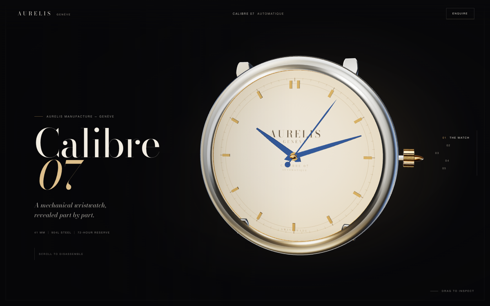

# Calibre Scroll Studio

A skill for building a release-grade, zero-asset Three.js luxury watch that disassembles as the
visitor scrolls. It packages the working **Aurelis Calibre 07 — Anatomy of a Second** site as a
template, plus the timeline maths, geometry notes, verification gate and release procedure.



## Install

Add the catalog to `opencode.jsonc`:

```jsonc
{
  "skills": ["https://somphol.github.io/opencode-skills/"]
}
```

Or clone/copy this folder into `~/.config/opencode/skills/calibre-scroll-studio`.

## Use it

```sh
node scripts/new-project.mjs --out ~/Projects/my-watch
cd ~/Projects/my-watch
npm install
npm run verify
python3 -m http.server 4173
```

`npm install` is dev-only (Puppeteer for the release gate). The site itself has no build and no
runtime dependencies.

## What is inside

- `assets/aurelis-calibre-07/` — the complete reference site, ready to reskin. Five chapters, a
  procedural watch, 24 headless checks, docs and screenshots.
- `references/` — the source brief, method, geometry, timeline, verification, lessons, release and
  build log.
- `scripts/new-project.mjs` — copies the template and prints the customization checklist.
- `scripts/scaffold-test.mjs` — proves the template by copying it and, with `--run`, installing and
  running the gate.

## What to change first

1. Brand names, copy and chapter titles (`index.html`, dial canvas strings in `src/watch.js`).
2. Palette and type tokens (`styles.css` and `src/environment.js`).
3. URLs: canonical/OG, `robots.txt`, `sitemap.xml`, `404.html`, the colophon.
4. The watch details: dial colours, case proportions, movement layout.
5. Keep the timeline contract and the release gate intact.

## Reference

- **Live:** <https://somphol.github.io/aurelis-calibre-07/>
- **Source:** <https://github.com/somphol/aurelis-calibre-07>
- **Brief:** 17 words; the source video's prompt is much longer. See
  `references/source-brief.md`.
- **Built with:** OpenCode 2.2.6 + DeepSeek V4.1 Flash. The session ledger is in the reference
  project's `STATE.md`.

## Licence

MIT for the code and template. Fonts: SIL Open Font License 1.1. Three.js: MIT. The fictional maison
is not a trademark to adopt. See `ATTRIBUTION.md` and the template's `LICENSE`.
