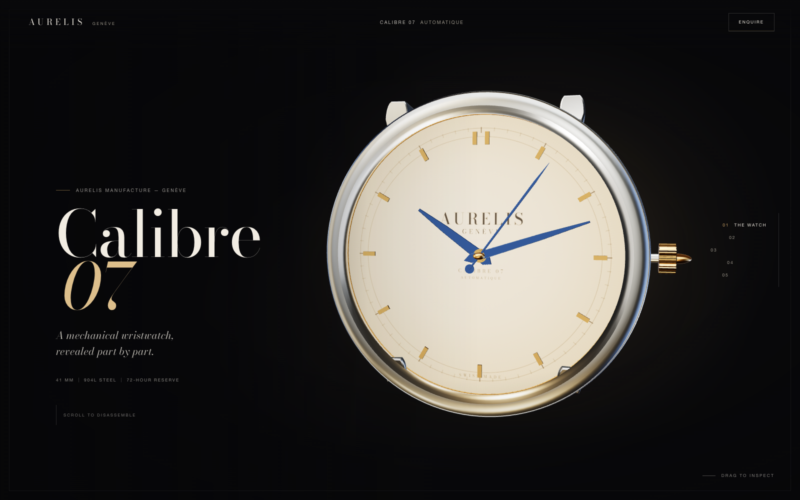

# Aurelis Calibre 07 — Anatomy of a Second

A single-page, scroll-driven WebGL study of a mechanical wristwatch. The Calibre 07 assembles
in front of you, comes apart as you scroll, and returns at the end. Everything you see — case,
dial, hands, bridges, wheels, balance, jewels, lugs, even the printed dial artwork — is
generated at runtime. There are no model files and no image assets.

**Live:** <https://somphol.github.io/aurelis-calibre-07/>  
**Release gate:** 24/24 headless checks passing · Chrome 156  
**Built with:** [OpenCode](https://opencode.ai/) 2.2.6 + DeepSeek V4.1 Flash



## The brief

> “Build an immersive single-page 3D website showcasing a luxury mechancal wristwatch that
> disassembles as the user scrolls.”

That was the entire prompt — 17 words, typo included. The [source video](https://www.youtube.com/watch?v=jTFGF4tCKTM)
carries a much longer prompt. This project was a deliberate test of what DeepSeek V4.1 Flash in
OpenCode could infer from one sentence: the narrative, the watch architecture, the exploded-view
choreography, the art direction, the verification gate and the release process all came from that
brief. Read the full experiment note in [`docs/STUDY.md`](docs/STUDY.md).

## What it is

- Five editorial chapters: **The Watch**, **The Dial**, **The Movement**, **The Case**, **The Whole**
- A procedural watch in 23 separable assemblies with a two-stage explosion and a timed reassembly
- Scroll-linked camera choreography, floating part labels, chapter rail and progress line
- A fictional “private viewing” dialog and a colophon that records the one-sentence brief
- Fully offline after load: Three.js, fonts, CSS and textures are all local
- A session ledger (`STATE.md`, `state.json`) with wall-clock time and token counts

It is **not** a shop, a CMS, or an accurate horological simulation. Aurelis is a fictional
maison, and the copy, price and appointments are fiction.

## Run it

```sh
npm install          # dev-only: puppeteer-core for the release gate
npm run serve        # http://localhost:4173
```

The site needs an HTTP server: ES modules and the import map do not run from `file://`.
`python3 -m http.server 4173` works just as well.

## Verify and record

```sh
npm run verify       # 24 headless checks + release screenshots
npm run state        # rebuild STATE.md + state.json from the OpenCode ledger
```

The gate starts its own server, drives desktop and mobile viewports, checks the scroll timeline,
the exploded state, hand tracking, label collisions, the colophon, the enquiry dialog, reduced
motion and the render budget, then rewrites the images in `screenshots/`.

`CHROME_PATH=/path/to/chrome` overrides Chrome discovery. `npm run screenshots` regenerates
ad-hoc frames with `?t=<0…1>&still` and a chosen `W`/`H` viewport.

## Use it

| Action | Result |
| --- | --- |
| Scroll | Disassemble / reassemble the watch and move through the chapters |
| Hover the watch | Slight parallax |
| Drag the watch (mouse) | Inspect it from another angle |
| Chapter rail | Jump to a chapter; the gold line tracks progress |
| Enquire | Open the private-viewing dialog (nothing is sent) |
| Colophon | The brief, the experiment, the model and the session ledger |
| `?t=0.75` | Freeze the timeline at 75% for inspection or screenshots |

Touch scrolling deliberately wins over dragging on mobile; the rail and callouts are hidden there
so the watch keeps the upper half of the screen.

## Architecture

```
index.html            semantic shell, copy, import map, dialogs
styles.css            all visual behaviour and responsive layout
src/main.js           renderer, scroll→timeline mapping, camera keys, labels, UI, dialogs
src/watch.js          procedural case, dial, hands, movement and part choreography
src/environment.js    procedural studio environment map and material palette
scripts/verify.mjs    release gate (24 checks) + screenshots
scripts/state.mjs     OpenCode session ledger → STATE.md / state.json
vendor/               pinned Three.js r170 (MIT)
fonts/                Bodoni Moda latin + italic (OFL) and its licence
docs/                 architecture, timeline, build log, study, verification, reproduction
```

**The watch** uses a simple unit system: the case radius is `1.0`, the dial `0.884`, and the
movement sits between `z = -0.11` and `z = 0.03`. Parts carry a base transform, a first
displacement/window, an optional second displacement/window and a retraction for reassembly.
`watch.update(t, elapsed)` applies those transforms, spins the wheel train, breathes the balance
and sweeps the seconds hand.

**The timeline** is not raw scroll. `main.js` measures the centres of the five chapters and
normalises scroll between the hero centre and the finale centre to `t ∈ [0, 1]`, so each chapter
lands on `t = 0, .25, .5, .75, 1`. Camera keys, watch rotation, the explosion and the copy windows
all key off that value. Scroll is damped; `prefers-reduced-motion` maps it directly and freezes the
escapement.

**The environment** is a tiny emissive scene baked with `PMREMGenerator.fromScene` — a warm strip,
a cool strip, an overhead softbox and a specular streak. It gives gold and steel their long
highlights without an HDR download.

**Callouts** project their 3D anchor through the camera each frame, flip near the right edge, fade
by chapter window, and use a collision pass so they never stack.

## Session ledger

The build was one OpenCode session. The aggregate ledger lives in [`state.json`](state.json) and a
readable version in [`STATE.md`](STATE.md).

| | |
| --- | --- |
| Model | DeepSeek V4.1 Flash (`deepseek-v4.1-flash`, `opencode-go`) |
| Harness | OpenCode 2.2.6, agent `build` |
| Elapsed | see [`STATE.md`](STATE.md) — captured at release preparation |
| Tokens | input, output, reasoning and cache read, all itemised in the ledger |
| Prompt | 17 words |
| Verification | 24/24 checks · 103 draw calls · 131,468 triangles |

`npm run state` reads the local OpenCode database **read-only** and copies only aggregate counts —
no conversation content and no machine path.

## Documentation

| Document | What it covers |
| --- | --- |
| [`AGENTS.md`](AGENTS.md) | Handoff: commands, layout, invariants, known issues, continuity |
| [`docs/STUDY.md`](docs/STUDY.md) | The one-sentence brief versus the longer video prompt |
| [`docs/ARCHITECTURE.md`](docs/ARCHITECTURE.md) | Scene graph, timeline maths, materials, labels |
| [`docs/TIMELINE.md`](docs/TIMELINE.md) | Chapter windows, camera keys, part choreography |
| [`docs/BUILD-LOG.md`](docs/BUILD-LOG.md) | Chronology, bugs, dead ends and fixes |
| [`docs/VERIFICATION.md`](docs/VERIFICATION.md) | The 24 checks, screenshots and limits |
| [`docs/REPRODUCE.md`](docs/REPRODUCE.md) | Step-by-step reproduction from a blank directory |
| [`docs/DEPLOYMENT.md`](docs/DEPLOYMENT.md) | GitHub Pages, relative paths, cache |
| [`CREDITS.md`](CREDITS.md) | OpenCode, DeepSeek, Three.js, Bodoni, prompt source |
| [`CHANGELOG.md`](CHANGELOG.md) | 1.0.0 release notes |

## Decisions and constraints

- **Everything procedural.** Do not add GLB/GLTF models or photographic textures; the no-asset
  constraint is what keeps the page honest. The dial is a 1024 px canvas texture.
- **Three.js is pinned at r170** and vendored. There is no build step and no runtime dependency; do
  not introduce a bundler or import from a CDN.
- **The normalized timeline is the contract.** Chapter centres are the anchors. If you change
  section heights, re-measure rather than hard-coding scroll pixels.
- **The case, crystal, bezel and lugs leave together** at the case chapter, so the movement stays
  legible and the exploded composition stays coherent. The hands track the lifted dial.
- **Reassembly is part of the scroll**, not a page reload: parts retract from `t = .815` with small
  per-part delays, and the finale is fully assembled at `t = 1`.
- **The fictional brand is intentional.** No network calls, no data storage and no real price; keep
  it that way.
- **Accessibility:** copy sections past the hero are `inert` until active so they cannot catch focus
  while invisible. The stage is decorative and hidden from the accessibility tree.

## Known limitations

- WebGL is required. Without it, the page shows the editorial copy and a single explanatory line
  instead of the watch.
- Verified in Chrome (headless, desktop, 390 × 844 mobile emulation). Safari/Firefox are untested;
  `backdrop-filter` and `dialog` degrade gracefully.
- The gear ratios, power reserve and water resistance are fiction.
- The mobile finale is taller than one viewport; the CTA is reached with the last few scroll
  centimetres rather than being visible immediately.
- The enquiry form is a local interaction only. Nothing is transmitted or persisted.

## Credits and licence

- **OpenCode** 2.2.6 — agent harness, session ledger, release tooling
- **DeepSeek V4.1 Flash** (`opencode-go`) — model
- [Three.js](https://threejs.org/) r170 — MIT
- [Bodoni Moda](https://fonts.google.com/specimen/Bodoni+Moda) — SIL Open Font License 1.1
- Concept reference: [the scroll-driven watch video](https://www.youtube.com/watch?v=jTFGF4tCKTM)
- The watch, brand, copy and imagery are original and fictional.

Code: MIT (see [`LICENSE`](LICENSE)). Fonts: OFL (see [`fonts/OFL.txt`](fonts/OFL.txt)). Three.js:
MIT (see [`THIRD_PARTY_NOTICES.md`](THIRD_PARTY_NOTICES.md)).
