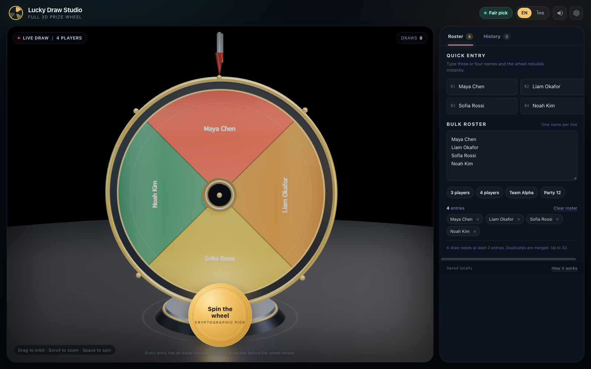

# Lucky Draw 3D Studio

An OpenCode skill for building and shipping a real 3D lucky-draw prize wheel: fair Web Crypto picks,
spin physics, a bilingual HUD, synthesized audio, local draw history, JSON/CSV export, four test
layers and a GitHub Pages release.

Built from the completed **Full 3D Lucky Draw & Prize Wheel Studio** project
([source](https://github.com/somphol/full-3d-lucky-draw-studio),
[live](https://somphol.github.io/full-3d-lucky-draw-studio/)) — 13 engine checks, 22 repository
checks, 18 in-page checks and 18 headless browser checks, with zero console errors.



## Install

Copy this folder into `~/.config/opencode/skills/lucky-draw-3d-studio`, or add the catalogue URL that
serves it to your OpenCode config:

```jsonc
{
  "skills": ["https://somphol.github.io/opencode-skills/"]
}
```

## Use

Ask for a 3D prize wheel, lucky draw, raffle wheel or spin-to-win stage. The skill walks through
engine-first fairness, the Three.js wheel, the roster/winner/history flow, bilingual copy, four test
layers, release documentation and publishing.

Scaffold the reference implementation:

```sh
node scripts/scaffold.mjs ~/Projects/my-lucky-draw
cd ~/Projects/my-lucky-draw
python3 -m http.server 8000
```

The scaffold copies the working three-file app and its two images. Replace the sample names, palette,
presets, title, links and documentation before shipping.

## Contents

- `SKILL.md` — when to use, done gates, non-negotiables, seven-phase workflow, debugging table.
- `references/FAIRNESS.md` — uniform pick, landing rotation, easing, peg ticks, invariants.
- `references/SCENE.md` — wheel constants, scene graph, label rules and visual pitfalls.
- `references/UI.md` — IDs, state, data flows, i18n, persistence, accessibility, breakpoints.
- `references/VERIFY.md` — four test layers, harness flags, handshakes.
- `references/RELEASE.md` — screenshots, docs set, `state.json`, publishing, live checks.
- `assets/reference/` — the shipped v1.0.0 `index.html`, `style.css`, `script.js` and images.
- `scripts/scaffold.mjs` — copies the reference into a new project directory.

## What makes this different from a wheel demo

- The winner is chosen before the animation, with rejection sampling over `crypto.getRandomValues`.
- The landing rotation is proven in tests, not eyeballed; every slice round-trips for 2–32 entries.
- The wheel face is a generated 2048² canvas texture with readable labels for small and large rosters.
- The reveal, history, exports, bilingual copy, reduced-motion path and handoff are release-grade.

## Licence

MIT. Three.js `0.169.0` is MIT. See [ATTRIBUTION.md](ATTRIBUTION.md).
