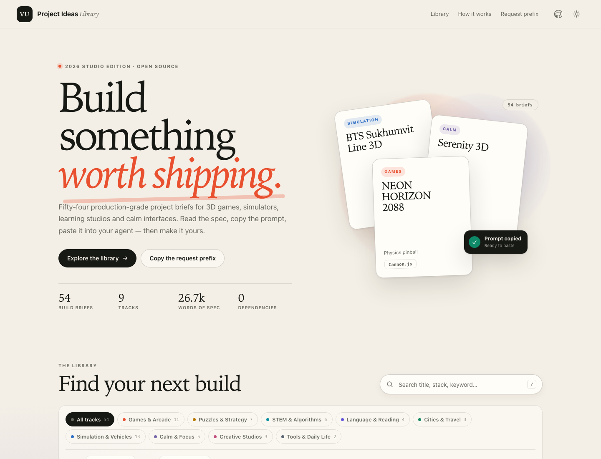

# VU Project Ideas Studio

An OpenCode skill for turning a long prompt list into a **searchable, copy-ready project catalog**:
parse the blocks, merge duplicates, curate metadata, keep one request prefix, generate 54 Markdown
prompts, add search/filters/deep links, verify at 390 px, publish to GitHub Pages and record time and
tokens.



## Install

Add the catalog URL to `opencode.jsonc`:

```jsonc
{
  "skills": ["https://somphol.github.io/opencode-skills/"]
}
```

Or copy this directory to `~/.config/opencode/skills/vu-project-ideas-studio`.

## Use

Ask for a browsable catalog of project briefs, assignment prompts or hackathon ideas — especially when
the source is a long pasted list with a repeated request wrapper. The skill tells the agent to audit
the list, build a data pipeline, ship a static UI, verify in a real browser and write the release
handoff.

Do **not** use it to build the projects themselves. Copy a brief into a coding agent, then use a
project-specific skill.

## Scaffold

```sh
node scripts/new-project.mjs --out ~/Projects/my-ideas-catalog
cd ~/Projects/my-ideas-catalog
python3 -m http.server 4173
npm test
```

The scaffold copies the complete working reference (54 briefs, build, tests, docs). Replace the source,
metadata, prefix, tracks and copy before publishing. **Do not ship the VU briefs as your own content.**

Prove the skill from a clean temp directory:

```sh
node scripts/verify.mjs              # scaffold + static gate
node scripts/verify.mjs --browser    # also 31 headless Chrome checks
node scripts/verify.mjs --keep       # keep the temp project for inspection
```

## What is inside

| Path | Purpose |
| --- | --- |
| `SKILL.md` | model-facing workflow, gates, non-negotiables |
| `references/method.md` | parsing, metadata, data schema, UI contracts, adding a brief |
| `references/lessons.md` | 17 bugs that cost time and their fixes |
| `references/verification.md` | static + CDP browser gates and screenshots |
| `references/release.md` | docs set, Pages API, keychain discipline, state capture |
| `assets/reference/` | the complete working catalog, docs, tests and screenshots |
| `assets/preview.png` | catalog hero |
| `scripts/new-project.mjs` | copy the reference into a fresh directory |
| `scripts/verify.mjs` | scaffold into a temp dir and run the gates |

## Reference

- Live: <https://somphol.github.io/vu_project_ideas/>
- Source: <https://github.com/somphol/vu_project_ideas>
- 54 briefs · 9 tracks · 26,748 words · 365 static checks · 31 browser checks

## Provenance

Built from **VU Project Ideas** (MIT, © 2026 Somphol Boonjing) in one OpenCode session with **DeepSeek
V4.1 Flash**. The reference contains the briefs supplied for that catalog; code, docs and tests are
MIT. See `ATTRIBUTION.md`.
